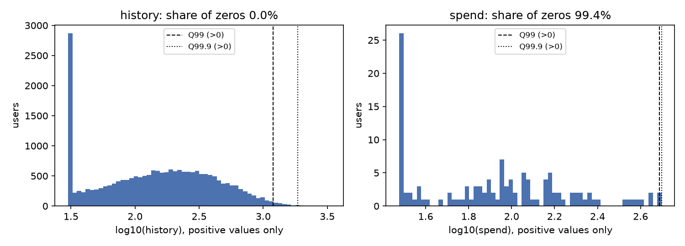
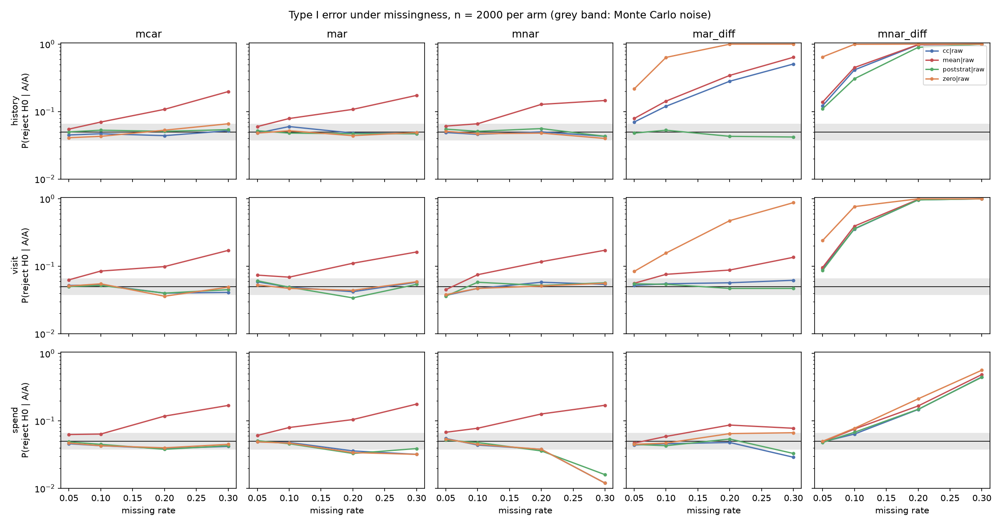
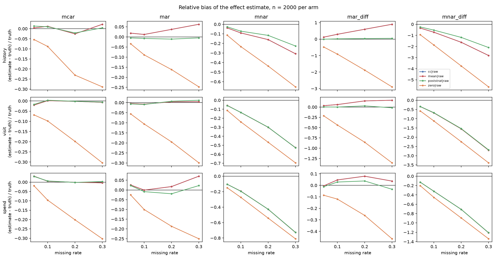
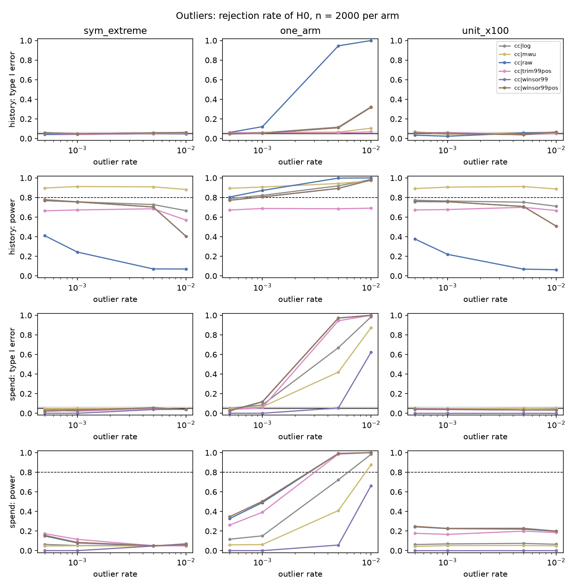
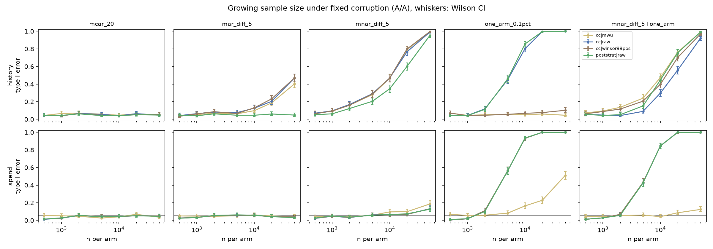
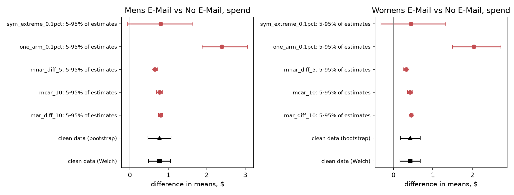
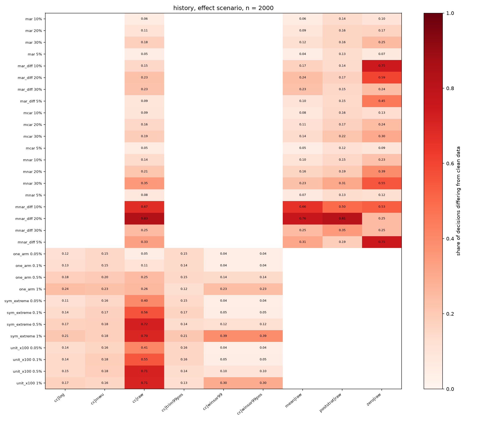

# Missing Values and Outliers in A/B Tests: When Dirty Data Changes the Decision

**A simulation study on the open Hillstrom e-mail dataset**

Abdihamitov, November 2026

Code, data checksums, raw results and the executed notebook: <https://github.com/Abdihamitov/A-B-Test-Runs-and-Outliers-When-Dirty-Data-Changes-Decisions>

## Abstract

Product A/B tests are computed from event logs, and logs lose events and collect junk: bots, duplicates, amounts recorded in the wrong units. Analysts usually drop the empty rows or cap values at the 99th percentile and rarely check what that did to the conclusion. We build a semi-synthetic simulation on the open Hillstrom dataset (64,000 customers, an e-mail campaign with a randomized control). Pairs of samples are drawn repeatedly from the control group, an effect of known size is injected into one of them when needed, and the data are then corrupted by a chosen mechanism. We vary the missingness mechanism (MCAR, MAR, MNAR, in both arms or in one arm only), the missing rate (5 to 30%), the type and rate of outliers, and the sample size (500 to 50,000 per arm). For the Welch t-test, the two-proportion z-test, the Mann-Whitney test, the bootstrap and post-stratification we measure type I error, power, bias, confidence interval coverage and the share of decisions that differ from the analysis of the same data without corruption. Symmetric corruption mostly costs power. Corruption confined to one arm produces bias that does not shrink with sample size: 5% value-dependent loss in one arm pushes the false positive rate of a correct-looking test from 6.8% at 500 users per arm to 99% at 50,000. Mean imputation inflates type I error exactly as a simple formula predicts, percentile winsorization destroys a zero-inflated revenue metric, and a sample ratio mismatch check stays silent in the range where the bias is already visible.

**Keywords:** A/B testing, missing data, outliers, Welch t-test, winsorization, type I error, sample ratio mismatch, Monte Carlo simulation.

## 1. Introduction

The decision from an A/B test usually fits in one line of a report: revenue per user changed by so much, the p-value is such, ship it. Behind that line sits a chain of client-side tracking, an event queue, ETL jobs and a reporting table. Any link can lose or distort part of the data. An ad blocker drops analytics requests. A mobile SDK crashes on an old Android version. A payment gateway times out and the order never reaches the log. A crawler hits the new version of a page a thousand times. Somewhere in a pipeline an amount in cents lands in a column of dollars. The analyst sees all of this as empty cells and suspiciously large values.

The standard response is just as familiar. Empty rows are dropped, or filled with zero ("no event means no purchase"). Large values are capped at the 99th or 99.9th percentile. Both steps look harmless, and in most textbook examples they really are. The catch is that harmlessness depends on the mechanism that corrupted the data, and the analyst almost never knows that mechanism.

A small example shows where the line runs. Suppose both arms randomly lose a fifth of their orders. Arm means do not move, the sample shrinks by 20%, the test loses some power, and that is all. Now suppose the new checkout page fails more often on large baskets, so arm B loses the 5% most expensive orders. The mean in B drops for a reason unrelated to the quality of the new page. With a large enough sample the test will confidently report an effect that does not exist, or miss a real one. The second case loses four times less data and does far more damage.

**Research question.** Under which mechanisms and rates of missing values and outliers do the standard analysis procedures (Welch's test after dropping missing rows, zero or mean imputation, winsorization, the Mann-Whitney test, post-stratification) keep the nominal type I error and an unbiased effect estimate, and under which do they change the decision?

We split it into four sub-questions:

- **RQ1.** How do the missingness mechanism (MCAR, MAR, MNAR) and whether it affects both arms or one arm change type I error, power and bias?
- **RQ2.** Which outlier treatments keep type I error under control, and what do they cost in power and bias?
- **RQ3.** Does a larger sample fix the problems caused by corruption?
- **RQ4.** How much does corruption change the conclusions of a real comparison in the Hillstrom data, where the true effect is unknown?

**Hypotheses.** Several follow from simple algebra (Section 3.5); the simulation checks them on a real, heavily skewed distribution and measures their size.

- **H1.** Missingness with the same mechanism and rate in both arms does not inflate type I error under complete case analysis. It reduces power roughly as a sample smaller by the missing rate would.
- **H2.** Missingness in one arm under MAR or MNAR biases the effect estimate, and type I error grows with sample size.
- **H3.** Filling missing values with the arm mean understates the standard error and inflates type I error even under MCAR, to about $2\bar\Phi(1.96(1-r))$ for missing rate $r$.
- **H4.** Outliers equally frequent in both arms mainly destroy power. Outliers in one arm produce false positives. Winsorization at a threshold shared by both arms brings type I error back to nominal at the price of bias.
- **H5.** A sample ratio mismatch (SRM) check catches one-arm missingness only when $n r^2/(2-r)$ clearly exceeds the $\chi^2_1$ critical value (10.83 at $p<0.001$). For small samples and missing rates the corruption goes unnoticed.

**Contributions.**

1. An open Python test bench where the corruption mechanism, rate, sample size and handling method are parameters, and every result is stored with library versions and a checksum of the data.
2. A comparison of handling methods on one set of metrics: type I error, power, bias, coverage, and a metric that a product team understands directly, the share of decisions that changed compared with the clean analysis.
3. Analytical benchmarks (mean imputation, zero imputation, SRM sensitivity) against which the simulation can be checked. The simulation matches them.
4. Practical rules for choosing a handling method based on what is known about the corruption mechanism.

Section 2 reviews related work and the gap it leaves. Section 3 describes the data, the simulation design and the metrics. Section 4 reports the results, Section 5 discusses what they mean in practice, Section 6 lists limitations. Code is in the appendix and the repository.

## 2. Related work

### 2.1. Practice of online experiments

Most practical literature on A/B tests comes from engineering teams at large internet companies. The survey by Kohavi et al. [12] describes the basic setup: randomization by user, per-user metrics, the t-test, power analysis. It already mentions robots that distort metrics and recommends filtering them. The book by Kohavi, Tang and Xu [14] turns these recommendations into a system. Three of its topics matter here: capping heavy-tailed metrics to reduce variance, trustworthiness checks for an experiment, and checking the ratio of group sizes.

Another paper from the same group analyzes cases where an experiment's result turned out to be an artifact [13]. One of the causes is exactly variant-dependent data loss: a change in one arm affects which events reach the server. This is what we call differential missingness. The paper treats it as a set of incident reports, without quantifying how the error depends on the loss rate and the sample size.

### 2.2. Sample ratio mismatch

Fabijan et al. [6] classified the reasons why the observed ratio of group sizes differs from the designed one and proposed testing it with a chi-square test at a strict threshold. Chen, Liu and Xu [1] developed automatic diagnosis of such problems. An SRM check answers "did we lose users unevenly?", but it does not say how much the metric was distorted. If the loss affects the metric value rather than the user's presence (the order is lost, the visit is not), an SRM check on user counts will not see it at all. In our simulation SRM is computed on the number of rows with an observed metric, and we measure separately how often it fires before the bias becomes visible in the test.

### 2.3. Missing data theory

The classification of missingness mechanisms goes back to Rubin [19]: values are missing completely at random (MCAR), at random given observed variables (MAR), or depending on the unobserved value itself (MNAR). The monograph by Little and Rubin [16] and the book by van Buuren [21] cover the methods in detail: complete case analysis, weighting, multiple imputation. The review by Schafer and Graham [20] explains why mean imputation distorts variance.

The closest application of this theory to A/B tests is in clinical trials, where missing outcomes come from attrition. There it is well known that attrition that differs between arms is more dangerous than overall attrition, and for MNAR one reports bounds instead of a point estimate, for example Lee bounds [15]. Transferring these results to product metrics is not direct. Revenue metrics have a mass of zeros and a heavy right tail, samples are orders of magnitude larger, and data are lost through technical failures that may be tied to the variant's interface.

### 2.4. Robust statistics and outliers

Classical work on robust estimation [11] and Wilcox's applied guide [23] offer trimmed and winsorized means and tests based on them. Their goal is a location estimate that resists contamination. In an A/B test the target is usually different: the difference in means, because revenue per user translates directly into money. A winsorized mean estimates another quantity, and for skewed data the gap between the two can exceed the effect itself. How often this changes a ship decision is outside the scope of that literature.

### 2.5. Choosing a test for skewed metrics

Welch's test [22] does not assume equal variances and, in large samples, relies on the central limit theorem. Fagerland [7] showed that for large skewed samples the t-test behaves correctly, whereas the Mann-Whitney test can reject the hypothesis of equal means too often or too rarely because it tests a different hypothesis. Fay and Proschan [8] work out which test tests what under which assumptions. For us this means that switching to Mann-Whitney "for robustness" changes not only the method but also the question the test answers.

### 2.6. Covariates, post-stratification and variance reduction

CUPED [2] uses pre-experiment data to reduce variance. Miratrix, Sekhon and Yu [17] analyzed post-stratification in randomized experiments. In these works covariates serve precision. We use the same technique for a different purpose: if missingness depends on observed covariates (MAR), reweighting by strata should remove the bias. Checking this for heavy-tailed A/B metrics is one of our tasks.

### 2.7. Methodology of simulation studies

Morris, White and Crowther [18] proposed the ADEMP structure (aims, data-generating mechanisms, estimands, methods, performance measures) and asked authors to report Monte Carlo error. Section 3 follows this structure. Gelman and Carlin [9] introduced sign (type S) and magnitude (type M) errors for significant results. We compute both in the effect scenario: under corruption a significant result can have the wrong sign or be strongly exaggerated.

### 2.8. The gap

Put together, the picture looks like this. The A/B testing literature knows about data loss and bots, but describes them as incidents and rules of thumb. Missing data theory provides a precise language of mechanisms, but its typical applications (trials, surveys) deal with moderate samples and metrics without a large mass of zeros. Robust statistics offers tools against outliers, but judges them by the stability of a location estimate, not by whether the ship decision changes. We did not find a study that systematically compares corruption mechanisms, handling methods and sample sizes on one open dataset with a real revenue distribution, using decision change as an outcome. This work tries to fill that gap.

## 3. Methods

The design follows the ADEMP structure [18].

### 3.1. Data

**Main dataset: Hillstrom E-Mail Analytics.** Kevin Hillstrom published the dataset in March 2008 as an open challenge for analysts [10]. It contains 64,000 customers who had purchased within the previous twelve months. They were randomly split into three groups: an e-mail featuring men's merchandise (Mens E-Mail, 21,307 customers), an e-mail featuring women's merchandise (Womens E-Mail, 21,387) and a control group without e-mail (No E-Mail, 21,306). Outcomes were tracked for two weeks after the campaign.

The file is downloaded by the code from the URL in `abtest_sim/data.py`. The SHA-256 checksum of the file used for all results is `0e5893329d8b93cefecc571777672028290ab69865718020c78c7284f291aece`.

| Column | Type | Role in this study |
|---|---|---|
| `recency` | integer, months since last purchase | covariate for MAR and strata |
| `history` | dollars spent in the past year | continuous skewed metric (as a distribution, see below) |
| `channel` | Phone / Web / Multichannel | covariate for MAR and strata |
| `newbie` | 0/1, new customer | covariate for MAR and strata |
| `segment` | experiment arm | split into groups |
| `visit` | 0/1, visited the site | binary metric |
| `conversion` | 0/1, purchased | binary metric (experiment 4 only) |
| `spend` | dollars spent during the two weeks | zero-inflated, heavy-tailed metric |

The `history` column describes behavior before the experiment and is, by meaning, a covariate. In the simulation it serves only as a *template distribution* for a continuous, positive, skewed metric (like average order value or time in app). No conclusions about the e-mail campaign are drawn from it. This is a deliberate assumption: we need a real heavy-tailed distribution, and almost all values of `spend` are zero.

**Table 1.** Descriptive statistics of the control group, $n = 21{,}306$ (`exp_0_eda.py`, `results/eda_metrics.csv`).

| Metric | Mean | SD | Skewness | Share of zeros | Q99 | Q99.9 | Q99 of positives | Max |
|---|---:|---:|---:|---:|---:|---:|---:|---:|
| history | 240.88 | 252.74 | 2.36 | 0 | 1191.89 | 1865.14 | 1191.89 | 3345.93 |
| visit | 0.106 | 0.308 | 2.56 | 0.894 | 1 | 1 | 1 | 1 |
| conversion | 0.0057 | 0.075 | 13.10 | 0.994 | 0 | 1 | 1 | 1 |
| spend | 0.653 | 11.59 | 26.37 | 0.994 | 0 | 165.85 | 487.64 | 499.00 |



Two facts from Table 1 shape the rest of the study. First, only 122 of 21,306 control customers bought anything, so `spend` is zero for 99.4% of users and its 99th percentile is exactly zero. Second, the covariates are associated with the metrics. The Spearman correlation of `history` with `recency` is $-0.217$ and with `newbie` is $0.094$; the mean `history` is 516.6 for Multichannel customers against 200.5 (Phone) and 204.4 (Web). For `visit` the correlation with `recency` is $-0.083$ (`results/eda_covariates.csv`). MAR missingness driven by these covariates will therefore shift the means of `history` noticeably and of `visit` and `spend` only slightly.

**Additional sources.** The code also supports synthetic data with a known dependence of metrics on covariates (`SOURCE=synthetic`, parameters in `make_synthetic`) and the Cookie Cats mobile game A/B test from Kaggle [25] (`SOURCE=cookie_cats`, downloaded manually). Results in this paper use Hillstrom only.

### 3.2. Data-generating mechanism

One Monte Carlo replication:

1. **Population.** Metric values and covariates of the Hillstrom control group (21,306 rows). The empirical distribution of the control is treated as the population. This is an assumption: the real user population is larger and its tail may differ.
2. **Samples.** Two independent samples of $n$ rows each (arms A and B) are drawn with replacement. Both come from the same distribution, so there is no true difference.
3. **Effect** (only in the `effect` scenario). A relative effect $\delta$ is injected into B:

    - continuous metrics: $y_B \leftarrow y_B(1+\delta)$;
    - binary metrics: zeros in B turn into ones with probability $q = \delta p_0/(1-p_0)$, so the proportion grows by a factor $(1+\delta)$;
    - for `spend` the amounts are multiplied, i.e. the effect is in order value only, not in conversion (a simplifying assumption).

    The effect size is chosen so that the test has about 80% power on clean data at the given $n$ under the normal approximation: $\delta(n) = (z_{0.975}+z_{0.8})\,\sigma\sqrt{2/n}\,/\,\mu \approx 2.80\,\sigma\sqrt{2/n}\,/\,\mu$. This makes results comparable across $n$. The true difference is $\Delta = \delta\mu$. The resulting relative effects are 18.6%, 9.3% and 4.2% for `history` at $n = 500$, 2000 and 10,000; 51.4%, 25.7% and 11.5% for `visit`; and 314%, 157% and 70% for `spend`. The numbers for `spend` already say something: with fewer than 1% buyers, a revenue metric is barely testable at these sizes.

4. **Reference decision.** Welch's test is run on the same samples before corruption. Its decision (reject $H_0$ or not) is the reference for the decision-change metric.
5. **Corruption.** Outliers and/or missing values are applied by one of the mechanisms below.
6. **Analysis.** Each handling method returns an effect estimate, a 95% confidence interval (when defined) and a p-value.

We use $N_{sim} = 1000$ replications per grid cell in experiments 1 and 2 and 500 in experiment 3 (large $n$ is expensive). Each cell's seed is spawned from the root seed 20261111 via `numpy.random.SeedSequence`, so results do not depend on the number of worker processes.

**Missingness mechanisms.** A missing value means the metric is unknown while the user and the covariates are known. This matches a typical lost log event. Let $r$ be the target average missing rate.

- **MCAR:** $P(\text{missing}) = r$ for every row.
- **MAR:** $P(\text{missing}_i) = \operatorname{expit}(a + 0.8\,z(\text{recency}_i) + 0.8\,[\text{channel}_i=\text{Phone}] - 0.5\,\text{newbie}_i)$, where $z$ denotes standardization and $a$ is found by bisection so that the population average equals $r$. Data of customers who have not bought for a long time and of the phone channel are lost more often. The coefficients are assumptions.
- **MNAR:** the probability grows with the rank of the value: $P_i = \min(0.95,\; r\,e^{\gamma u_i}/\overline{e^{\gamma u}})$, where $u_i$ is the value's position in the population distribution (mid-rank empirical CDF), $\gamma = 2$, and the normalization over the population gives average rate $r$ in an arm without effect. The largest value is lost about $e^2 \approx 7.4$ times more often than the smallest. Example: large orders go through extra checks and time out more often.
- **Differential variants** `mar_diff` and `mnar_diff`: the same mechanism applied to arm B only. Arm A loses nothing. This models a bug that exists only in the new version of the product.

One detail matters for MNAR. In the effect scenario values in B are larger, so their population ranks are higher and B loses more rows than A even under the symmetric mechanism. Symmetric MNAR therefore becomes slightly differential when there is an effect. This is a property of the mechanism, not an error in the model.

Grid: mechanisms {MCAR, MAR, MNAR, MAR-diff, MNAR-diff} $\times$ rates $r \in \{0.05, 0.10, 0.20, 0.30\}$ $\times$ $n \in \{500, 2000, 10{,}000\}$ $\times$ metrics {history, visit, spend} $\times$ scenarios {A/A, effect}: 360 cells.

**Outlier mechanisms.** Let $\varepsilon$ be the share of contaminated rows and $Q_{99.9}$ the 99.9th percentile of the population.

- **sym_extreme** (bots in both arms): with probability $\varepsilon$ a value is replaced by $M = 10\,Q_{99.9}\cdot U(0.5, 1.5)$ in each arm.
- **one_arm** (a bot or test account in B only): the same, in arm B only.
- **unit_x100** (unit error): with probability $\varepsilon$ a value is multiplied by 100 in both arms. For `spend` this affects only nonzero values, so the effective contamination rate is $\varepsilon$ times the share of buyers.

Outliers are applied after the effect: bot values do not depend on the product variant. Grid: types {sym_extreme, one_arm, unit_x100} $\times$ $\varepsilon \in \{0.0005, 0.001, 0.005, 0.01\}$ $\times$ $n \in \{500, 2000, 10{,}000\}$ $\times$ metrics {history, spend} $\times$ scenarios: 144 cells. Value outliers are undefined for the binary `visit`.

**Sample size (experiment 3).** Five fixed corruption scenarios (MCAR 20%; MAR-diff 5%; MNAR-diff 5%; one_arm 0.1%; MNAR-diff 5% together with one_arm 0.1%) at $n \in \{500, 1000, 2000, 5000, 10{,}000, 20{,}000, 50{,}000\}$: 140 cells.

**Real comparison (experiment 4).** Mens E-Mail and Womens E-Mail are compared with the control on `visit`, `conversion` and `spend` using the full data. The same data are then corrupted 200 times under five scenarios, and we count how often the conclusion differs from the clean one. The reference here is the clean analysis, not the truth: we measure the stability of the conclusion, not its correctness.

### 3.3. Handling methods and statistical tests

A handler is a pair "what to do with missing values | what to do with outliers".

| Handler | What it does | Test | Estimand |
|---|---|---|---|
| `cc|raw` | drop rows with missing values | Welch | difference in means |
| `zero|raw` | fill missing with 0 | Welch | difference in means |
| `mean|raw` | fill missing with the arm's mean | Welch | difference in means |
| `poststrat|raw` | post-stratification on 18 strata | z | difference in means |
| `cc|winsor99` | cap values above the pooled Q99 | Welch | difference in winsorized means |
| `cc|winsor99pos` | same, threshold = Q99 of positive values | Welch | same |
| `cc|trim99pos` | drop values above Q99 of positives | Welch | difference in trimmed means |
| `cc|log` | transform $\log(1+y)$ | Welch | difference in mean logs |
| `cc|mwu` | no change | Mann-Whitney | $P(Y_B > Y_A)$ |

Winsorization and trimming thresholds are computed on the *pooled* sample of both arms. A per-arm threshold would make the treatment itself depend on the effect. For `history` all values are positive, so `winsor99` and `winsor99pos` coincide.

**Why these tests.**

*Welch's t-test* is the main test because product A/B tests decide on the difference in means, and after corruption the arm variances almost certainly differ (outliers or losses in one arm). The pooled-variance Student test is not appropriate there. The statistic and the interval are

$$\hat\Delta = \bar y_B - \bar y_A,\qquad SE = \sqrt{\frac{s_A^2}{n_A}+\frac{s_B^2}{n_B}},\qquad \nu = \frac{SE^4}{\dfrac{(s_A^2/n_A)^2}{n_A-1}+\dfrac{(s_B^2/n_B)^2}{n_B-1}},$$

$$t = \hat\Delta/SE,\qquad p = 2\,P(T_\nu > |t|),\qquad \text{CI}_{95\%} = \hat\Delta \pm t_{0.975;\,\nu}\cdot SE.$$

The implementation (`abtest_sim/stats.py::welch`) is checked by a unit test against `scipy.stats.ttest_ind(equal_var=False)` and its `confidence_interval` method.

*The two-proportion z-test* is used in experiment 4 for `visit` and `conversion`, as the standard choice for conversion rates. The p-value uses the pooled proportion (under $H_0$ the proportions are equal), the Wald interval uses separate variances:

$$\text{CI}_{95\%} = (\hat p_B - \hat p_A) \pm 1.96\sqrt{\frac{\hat p_A(1-\hat p_A)}{n_A}+\frac{\hat p_B(1-\hat p_B)}{n_B}}.$$

In the simulation binary metrics are analyzed with Welch's test: for large $n$ it is practically identical to the unpooled z-test, and one test simplifies the comparison of handlers.

*The Mann-Whitney test* is included because it is often recommended as "robust to outliers". It tests $P(Y_B > Y_A) = 1/2$, not equality of means [8]. For `spend`, where 99.4% of values are zero, almost all pairs are ties. We use the asymptotic version with a tie correction (`scipy.stats.mannwhitneyu(method="asymptotic")`). As an effect estimate we record $P(Y_B>Y_A)+\tfrac12 P(Y_B=Y_A)-\tfrac12$; no interval is computed.

*The log transform* tames the heavy tail but compares mean logs, i.e. roughly geometric means. For a revenue decision this is a different quantity, so bias and coverage are not computed for `cc|log` and `cc|mwu`, only rejection rates.

*The percentile bootstrap* is used in experiment 4 to check the normal approximation for `spend`: arms are resampled independently $B = 2000$ times, and the interval is the 2.5% and 97.5% quantiles of $\bar y_B^* - \bar y_A^*$ [5].

*Post-stratification* with common weights. Users are split into 18 strata: channel (3) $\times$ new customer (2) $\times$ recency (1-4, 5-8, 9-12 months). The weight $w_s$ of a stratum is its share among all users of both arms, including rows with a missing metric, since their covariates are known. The estimate and its variance are

$$\hat\Delta_{PS} = \sum_s w_s(\bar y_{Bs} - \bar y_{As}),\qquad \widehat{\operatorname{Var}} = \sum_s w_s^2\left(\frac{s_{As}^2}{n_{As}}+\frac{s_{Bs}^2}{n_{Bs}}\right),$$

with means and variances over observed values in the stratum, and the interval is $\hat\Delta_{PS} \pm 1.96\sqrt{\widehat{\operatorname{Var}}}$. If missingness depends only on the stratum, the observed values inside a stratum represent the whole stratum and the bias disappears. Our MAR depends on continuous `recency`, while the strata use it in three bands, so some residual bias is possible. Against MNAR the method does not help: within a stratum the large values are still the ones lost.

The common weights are essential. With weights computed separately per arm, the random difference in stratum composition between arms enters the estimate but not the variance formula, and the interval becomes too narrow. During development this version gave coverage of about 0.91 instead of 0.95 even without missing data. The corrected version is checked by the unit test `test_poststrat_coverage_without_missing`.

**SRM check.** For each corrupted pair of samples a chi-square goodness-of-fit test compares the numbers of rows with an observed metric to a 50/50 split. We use the threshold $p < 0.001$ [6] and record the share of replications where it fires.

### 3.4. Performance measures

| Measure | Definition | Scenario |
|---|---|---|
| Rejection rate | $\frac{1}{N_{sim}}\sum \mathbb 1[p_k < 0.05]$ | A/A: type I error; effect: power |
| CI of the rate | Wilson interval [24] | both |
| Bias, % of $\mu$ | $100\,(\overline{\hat\Delta}-\Delta)/\mu$ | both |
| Relative bias | $(\overline{\hat\Delta}-\Delta)/\Delta$ | effect |
| Coverage | share of replications with $\Delta \in [\text{lo}, \text{hi}]$ | both |
| CI width, % of $\mu$ | $100\,\overline{(\text{hi}-\text{lo})}/\mu$ | both |
| Decision change (flip) rate | share of replications where the decision after corruption differs from the clean one | both |
| Type S error | share of significant results with sign opposite to $\Delta$ | effect |
| Type M error | $\overline{\lvert\hat\Delta\rvert}/\Delta$ among significant results | effect |
| SRM detection | share of replications with $p_{SRM} < 0.001$ | exp. 1, 3 |

In experiment 4 the effect is also described by the relative lift $\bar y_B/\bar y_A - 1$ and Hedges' $g$.

**Monte Carlo error.** With nominal type I error $\alpha = 0.05$ and $N_{sim} = 1000$ the rejection rate has standard error $\sqrt{0.05\cdot 0.95/1000} \approx 0.0069$. The Wilson interval for 50 rejections out of 1000 is $[0.038, 0.065]$; for 25 out of 500 it is $[0.034, 0.073]$. A type I error inside this band is not distinguishable from nominal; the figures show the band in grey. The standard error of 95% coverage at 1000 replications is about 0.007, so coverage between 0.936 and 0.964 counts as nominal.

**Multiple comparisons.** Experiments 1 and 2 contain hundreds of cells. Even a perfect method would leave about 5% of cells outside the Monte Carlo band by chance. We draw conclusions from consistent patterns (monotone growth with the corruption rate, repetition across $n$ and metrics), not from single cells.

### 3.5. Analytical benchmarks

Several outcomes can be derived in advance. Agreement with them checks the code; disagreement would need an explanation.

**Mean imputation under MCAR.** Suppose an arm has $n$ rows, of which $n(1-r)$ are observed with sample variance $s^2$. After filling with the mean, the sample variance of the array is about $(1-r)s^2$, and the test computes the standard error of the mean as $s\sqrt{(1-r)/n}$. The real standard error of the observed mean is $s/\sqrt{n(1-r)}$. The ratio is $(1-r)$, so the t statistic is inflated by $1/(1-r)$ and the expected type I error is

$$\alpha_{\text{mean}}(r) \approx 2\,\bar\Phi\big(1.96\,(1-r)\big):\quad r=0.05 \to 0.063;\ \ r=0.10 \to 0.078;\ \ r=0.20 \to 0.117;\ \ r=0.30 \to 0.170.$$

**Zero imputation under differential MCAR.** If B randomly loses a share $r$ of values and the gaps are filled with zero, $E[\bar y_B] = (1-r)\mu_B$ and the bias of the difference is $-r\mu_B$. In an A/A test with $r = 0.05$ that is $-5\%$ of the mean, larger than many product effects. With symmetric MCAR both arms are multiplied by $(1-r)$ and type I error stays nominal.

**Bias and sample size.** If a method leaves bias $b \ne 0$, the A/A rejection probability is approximately

$$P(\text{reject}) \approx \bar\Phi\!\left(1.96-\frac{b}{\sigma\sqrt{2/n}}\right)+\Phi\!\left(-1.96-\frac{b}{\sigma\sqrt{2/n}}\right) \xrightarrow[n\to\infty]{} 1.$$

This is hypothesis H2: with a biased method a larger sample makes a false conclusion more confident.

**Power under symmetric MCAR.** With an effect sized for $n$ but effective sample $n(1-r)$, power is $\Phi(2.80\sqrt{1-r}-1.96)$: 0.78, 0.76, 0.71 and 0.65 for $r$ = 0.05, 0.10, 0.20, 0.30, assuming 80% power on clean data.

**Outliers in one arm.** If a share $\varepsilon$ of values in B is replaced by $M \gg \mu$, then $E[\bar y_B] - \mu \approx \varepsilon(M-\mu)$ and the variance in B grows by about $\varepsilon M^2$. The shift relative to the standard error grows as $\sqrt n$, so for a fixed share of bots a false positive becomes almost certain as $n$ grows. For `history`, $M \approx 10 \cdot 1865 = 18{,}650$ on average, and $\varepsilon = 0.001$ gives a shift of $\varepsilon(M-\mu)/\mu \approx 7.6\%$ of the mean, close to the effect the test is designed to find at $n = 2000$ (9.3%).

**Percentile winsorization of a zero-inflated metric.** If fewer than 1% of values are nonzero, $Q_{99} = 0$ and winsorization at the pooled Q99 replaces every value with zero. For `spend` this is the case (Table 1).

**Winsorizing at Q99 of positives.** With a share of buyers $\pi$, an arm holds about $n\pi$ buyers and $n\varepsilon$ bots. Bots make up roughly $\varepsilon/(\pi+\varepsilon)$ of positive values. Once this exceeds 1%, the threshold falls into the bot region. For `spend`, $\pi = 0.0057$, so at $\varepsilon = 0.001$ bots are about 15% of positive values and `winsor99pos` cannot remove them.

**SRM sensitivity.** If B loses a share $r$ of rows, the expected chi-square statistic is roughly $n r^2/(2-r)$. At $p < 0.001$ the $\chi^2_1$ critical value is 10.83. The expected statistic reaches it at

$$n^* \approx \frac{10.83\,(2-r)}{r^2}:\quad r=0.05 \to 8400;\ \ r=0.10 \to 2100;\ \ r=0.20 \to 490;\ \ r=0.30 \to 210.$$

Around $n^*$ the check fires in about half of the replications, and well below $n^*$ almost never.

### 3.6. Software

| Component | Version |
|---|---|
| Python | 3.14.4 |
| numpy | 2.5.4 |
| pandas | 3.1.1 |
| scipy | 1.18.1 [26] |
| matplotlib | 3.11.2 |
| tabulate | 0.10.0 |
| pytest | 9.2.0 |

Every experiment writes `results/*.meta.json` with run time, library versions, $N_{sim}$ and seed. The full run took 13 minutes on 6 CPU cores: 347 s (experiment 1), 209 s (experiment 2), 172 s (experiment 3), 29 s (experiment 4).

### 3.7. Reproducing in 30 minutes

```bash
git clone https://github.com/Abdihamitov/A-B-Test-Runs-and-Outliers-When-Dirty-Data-Changes-Decisions.git ab
cd ab
python3 -m venv .venv && source .venv/bin/activate
pip install -r requirements.txt
QUICK=1 ./run_all.sh     # smoke test, a few minutes
./run_all.sh             # main run, N_SIM=1000, about 13 min on 6 cores
jupyter nbconvert --to notebook --execute --inplace notebooks/report.ipynb
python tools/build_pdf.py
```

Order of scripts and artifacts: unit tests; `exp_0_eda` (Table 1, Figure 1); `exp_1_missing` (`results/exp1_missing.csv`); `exp_2_outliers`; `exp_3_sample_size`; `exp_4_case_study`; `make_figures` (Figures 2 to 7); `make_tables` (`results/tables.md` with all summary tables). If the MineThatData server is slow, download the CSV by hand into `data/hillstrom.csv`. If the run does not fit into 30 minutes, set `N_SIM=500`.

## 4. Results

Every number below comes from a CSV in `results/` and the script named in the subsection. Tables T1 to T11 in `results/tables.md` contain the full grids; the tables in this section are excerpts.

**Calibration on clean data.** Before looking at corruption we check the test itself (column `clean_rej_rate`, experiment 1). For `history` and `visit` the A/A rejection rate averages 0.048 to 0.051 across cells at every $n$, inside the Monte Carlo band. Power on clean data is 0.73, 0.76 and 0.79 for `history` and 0.72, 0.76 and 0.78 for `visit` at $n$ = 500, 2000, 10,000: slightly below the 0.80 target, because the effect formula uses the normal approximation. For `spend` the picture is different. Its A/A rejection rate is 0.019 at $n = 500$ (the test is conservative), 0.044 at 2000 and 0.048 at 10,000, and its power is only 0.03, 0.24 and 0.52 although the effect was sized for 0.80. With about 3 buyers per arm at $n = 500$ the normal approximation fails. Power numbers for `spend` must therefore be compared with its own clean power, not with 0.80.

### 4.1. Experiment 1: missing values (RQ1)

Source: `results/exp1_missing.csv`, script `experiments/exp_1_missing.py`. Tests: Welch for `cc`, `zero`, `mean`; z-test for post-stratification.

**Type I error.**

**Table 2.** Type I error in A/A tests, $n = 2000$ per arm (excerpt from table T2). Values outside $[0.038, 0.065]$ differ from nominal.

| Metric | Mechanism | $r$ | cc | zero | mean | poststrat |
|---|---|---:|---:|---:|---:|---:|
| history | MCAR | 0.20 | 0.044 | 0.053 | 0.108 | 0.051 |
| history | MAR | 0.20 | 0.048 | 0.044 | 0.108 | 0.047 |
| history | MNAR | 0.20 | 0.050 | 0.048 | 0.128 | 0.056 |
| history | MAR-diff | 0.05 | 0.070 | 0.217 | 0.079 | 0.048 |
| history | MAR-diff | 0.20 | 0.282 | 0.999 | 0.344 | 0.043 |
| history | MAR-diff | 0.30 | 0.508 | 1.000 | 0.639 | 0.042 |
| history | MNAR-diff | 0.05 | 0.122 | 0.647 | 0.138 | 0.110 |
| history | MNAR-diff | 0.10 | 0.415 | 0.994 | 0.450 | 0.307 |
| history | MNAR-diff | 0.20 | 0.978 | 1.000 | 0.984 | 0.897 |
| visit | MAR-diff | 0.20 | 0.057 | 0.475 | 0.088 | 0.047 |
| visit | MNAR-diff | 0.10 | 0.357 | 0.767 | 0.394 | 0.361 |
| spend | MNAR-diff | 0.20 | 0.148 | 0.213 | 0.167 | 0.149 |
| spend | MNAR-diff | 0.30 | 0.450 | 0.566 | 0.488 | 0.445 |



*Symmetric mechanisms (H1).* In the three left columns of Figure 2 the lines for `cc`, `zero` and `poststrat` stay in the grey band for all rates and metrics, apart from a few conservative values for `spend` at high rates (0.032 under MAR and 0.012 under MNAR at $r = 0.30$), where losing buyers leaves only a handful of positive values. H1 holds: when both arms lose data the same way, the test stays honest, even if the lost values are the largest ones.

*Mean imputation (H3).* The `mean` line rises with the missing rate under every mechanism. Under MCAR at $n = 2000$ the observed type I error is 0.055, 0.070, 0.108 and 0.198 for `history`, 0.063, 0.064, 0.118 and 0.170 for `spend`, and 0.063, 0.085, 0.099 and 0.172 for `visit`, against the predicted 0.063, 0.078, 0.117 and 0.170. The formula from Section 3.5 describes the mechanism well, and the effect does not depend on $n$ (at $n = 10{,}000$: 0.065, 0.077, 0.113, 0.178 for `history`). Coverage of the 95% interval falls to 0.836 for `history` at $r = 0.30$ under MCAR (table T4).

*Differential MAR.* When only B loses data and the loss depends on covariates, complete case analysis is biased for `history`: type I error grows from 0.070 at $r = 0.05$ to 0.508 at $r = 0.30$. The bias is positive (B loses customers with long recency, who have smaller `history`), and in the effect scenario the estimate exceeds the truth by 12%, 29%, 60% and 90% of the true effect. Post-stratification removes it: type I error 0.042 to 0.053 and relative bias between $-0.01$ and $0.05$ across rates. For `visit` and `spend`, where covariates explain little, `cc` stays close to nominal (at most 0.062 for `visit` at $n = 2000$), but at $n = 10{,}000$ it reaches 0.187 for `visit` at $r = 0.30$, while post-stratification gives 0.045.

*Differential MNAR.* This is the dangerous case. With value-dependent loss in B, every method fails. For `history` at $n = 2000$, 5% loss already gives type I error 0.122 under `cc`, and 10% gives 0.415. Post-stratification helps a little (0.110 and 0.307) because strata are correlated with the value, but does not fix the problem. Zero imputation is the worst: 0.647 at 5% loss. For `spend` the bias is masked by noise at $n = 2000$ (0.049 at 5%) but becomes visible at higher rates (0.450 at 30%).

**Bias, power and wrong signs.**



Under symmetric MCAR the estimate is unbiased and power falls with the rate: 0.760, 0.729, 0.645 and 0.619 for `history` with `cc`, close to the predicted 0.78, 0.76, 0.71 and 0.65 once one accounts for the clean power of 0.76. Symmetric MNAR is not harmless in the effect scenario, because the arm with larger values loses more: relative bias of $-0.04$, $-0.09$, $-0.16$ and $-0.31$ for `history` and $-0.10$ to $-0.73$ for `spend`.

Differential MNAR erases the effect and then reverses it. For `history` with `cc` the relative bias is $-0.34$, $-0.72$, $-1.62$ and $-2.81$; for `visit` $-0.34$, $-0.69$, $-1.55$ and $-2.70$. Table 3 shows what this means for the decision.

**Table 3.** Differential MNAR, effect scenario, `history`, $n = 2000$, complete case analysis (`results/exp1_missing.csv`).

| $r$ | Power | Type S | Type M | Coverage |
|---:|---:|---:|---:|---:|
| 0.05 | 0.429 | 0.000 | 1.00 | 0.847 |
| 0.10 | 0.121 | 0.058 | 0.91 | 0.517 |
| 0.20 | 0.386 | 1.000 | 0.98 | 0.009 |
| 0.30 | 0.999 | 1.000 | 1.81 | 0.000 |

At 20% loss the test is "significant" in 39% of replications, and every one of those significant results has the wrong sign. At 30% it is significant almost always, always in the wrong direction, with an estimate 1.8 times the size of the true effect. A naive reading of power ("the test finds the effect 99.9% of the time") would be completely wrong here: the rejection rate counts rejections, not correct rejections. Zero imputation reverses the sign already at 10% loss (type S = 1.0 among 69% significant results).

**SRM check (H5).**

**Table 4.** Share of A/A replications where the SRM check fired, differential mechanisms (both give the same detection rate within noise).

| $n$ | $r = 0.05$ | $r = 0.10$ | $r = 0.20$ | $r = 0.30$ |
|---:|---:|---:|---:|---:|
| 500 | 0.000 | 0.000 | 0.57 | 1.00 |
| 2000 | 0.000 | 0.42 | 1.00 | 1.00 |
| 10,000 | 0.97 | 1.00 | 1.00 | 1.00 |

The detection rates follow the analytical threshold: at $r = 0.10$ the check fires in 42% of replications at $n = 2000$ (predicted $n^* \approx 2100$), at $r = 0.20$ in 57% at $n = 500$ ($n^* \approx 490$). On symmetric mechanisms it never fired. The important consequence is the gap: at $n = 2000$ and 5% MNAR-diff loss the check never fires, while `cc` already rejects in 12.2% of A/A tests for `history` and 9.2% for `visit`. In experiment 3 at $n = 5000$ the gap is wider: the check still never fires, and the false positive rate for `history` is 0.29.

### 4.2. Experiment 2: outliers (RQ2)

Source: `results/exp2_outliers.csv`, script `experiments/exp_2_outliers.py`. Tests: Welch (raw, winsor, trim, log), Mann-Whitney (mwu).

**Table 5.** Type I error (A/A) and power (effect), $n = 2000$ (excerpt from T6 and T7).

| Metric | Type | $\varepsilon$ | | raw | winsor99 | winsor99pos | trim99pos | log | mwu |
|---|---|---:|---|---:|---:|---:|---:|---:|---:|
| history | one_arm | 0.001 | type I | 0.121 | 0.053 | 0.053 | 0.059 | 0.058 | 0.063 |
| history | one_arm | 0.005 | type I | 0.946 | 0.110 | 0.110 | 0.057 | 0.116 | 0.065 |
| history | one_arm | 0.01 | type I | 1.000 | 0.319 | 0.319 | 0.068 | 0.323 | 0.105 |
| history | sym_extreme | 0.001 | power | 0.243 | 0.755 | 0.755 | 0.673 | 0.756 | 0.912 |
| history | sym_extreme | 0.01 | power | 0.070 | 0.405 | 0.405 | 0.570 | 0.666 | 0.882 |
| history | unit_x100 | 0.001 | power | 0.220 | 0.757 | 0.757 | 0.677 | 0.764 | 0.906 |
| spend | one_arm | 0.001 | type I | 0.116 | 0.000 | 0.118 | 0.058 | 0.085 | 0.066 |
| spend | one_arm | 0.005 | type I | 0.972 | 0.054 | 0.972 | 0.944 | 0.669 | 0.420 |
| spend | sym_extreme | 0.001 | power | 0.079 | 0.000 | 0.084 | 0.115 | 0.052 | 0.050 |
| spend | unit_x100 | 0.001 | power | 0.225 | 0.000 | 0.227 | 0.166 | 0.069 | 0.052 |



*Symmetric outliers kill power, not type I error (H4).* With bots in both arms the raw Welch test keeps its type I error (0.041 to 0.050 for `history`), because it accounts for the inflated variance. The price is power: for `history` it falls from 0.76 on clean data to 0.411 at $\varepsilon = 0.0005$, 0.243 at 0.001 and 0.070 at 0.01. One extreme value per thousand users is enough to make the test nearly useless. Winsorization restores power to 0.755 at $\varepsilon = 0.001$ but loses it again at $\varepsilon = 0.01$ (0.405), when outliers make up 1% of the pooled sample and lift the threshold. Unit errors behave the same way.

*Outliers in one arm produce false positives.* For `history` the raw test rejects in 12.1% of A/A tests at $\varepsilon = 0.001$ and 94.6% at $\varepsilon = 0.005$. Winsorization at the pooled threshold holds type I error while bots are rare (0.053 at $\varepsilon = 0.001$) and fails as they become common (0.110 at $\varepsilon = 0.005$, 0.319 at $\varepsilon = 0.01$). Capping does not remove a bot, it moves it to the threshold, and when 1% of the rows in B sit at the 99th percentile of the pooled data, they still shift the mean of B. Trimming above the threshold, which removes bot rows instead of capping them, stays at 0.057 to 0.068 at every rate.

*Winsorizing a zero-inflated metric.* For `spend` the pooled Q99 is zero, so `winsor99` turns the metric into zeros. At $n = 2000$ its rejection rate is 0.000 in every A/A and effect cell with $\varepsilon \le 0.001$; the bias is $-157\%$ of the control mean, i.e. the estimated effect is exactly zero while the true effect is 157% of the mean (table T8). A test that never rejects looks conservative, but the metric is gone.

*Winsorizing at Q99 of positives does not stop bots in sparse metrics.* As predicted in Section 3.5, with 0.57% buyers the bots exceed 1% of positive values already at $\varepsilon = 0.001$. `winsor99pos` gives exactly the same type I error as the raw test (0.118 against 0.116 at $\varepsilon = 0.001$; 0.972 at 0.005).

*Mann-Whitney and log.* For `history` the Mann-Whitney test has higher power than Welch in every cell (0.88 to 0.91 at $n = 2000$ under symmetric outliers and unit errors, about 0.99 at $n = 10{,}000$), because a multiplicative effect on a skewed positive variable is a shift in ranks. It is also more stable against one-arm bots (0.105 at $\varepsilon = 0.01$, against 1.0 for the raw test). But it answers a different question, and for `spend` its power under symmetric outliers and unit errors is 0.04 to 0.06, the level of the test size: the effect in order value among 0.6% of users barely moves the ranks. The log transform sits between the two.

*Bias of trimming and winsorization.* With a multiplicative effect, larger values in B are cut more. At the smallest $\varepsilon$ the bias of `trim99pos` for `history` is $-2.12\%$ of the mean, about 23% of the true effect (9.3%), and its power on nearly clean data is 0.67 instead of 0.76. Winsorization costs less: $-0.34\%$ of the mean, about 4% of the effect.

### 4.3. Experiment 3: sample size (RQ3)

Source: `results/exp3_sample_size.csv`, 500 replications per cell.

**Table 6.** Type I error (A/A) as a function of $n$ per arm, `history` (excerpt from T9).

| Scenario | Handler | 500 | 2000 | 5000 | 10,000 | 20,000 | 50,000 |
|---|---|---:|---:|---:|---:|---:|---:|
| MCAR 20% | cc | 0.042 | 0.066 | 0.056 | 0.040 | 0.064 | 0.048 |
| MAR-diff 5% | cc | 0.042 | 0.082 | 0.076 | 0.126 | 0.204 | 0.470 |
| MAR-diff 5% | poststrat | 0.048 | 0.062 | 0.046 | 0.046 | 0.060 | 0.048 |
| MNAR-diff 5% | cc | 0.068 | 0.168 | 0.290 | 0.468 | 0.766 | 0.990 |
| MNAR-diff 5% | poststrat | 0.052 | 0.122 | 0.204 | 0.346 | 0.600 | 0.952 |
| one_arm 0.1% | cc | 0.044 | 0.118 | 0.450 | 0.802 | 0.996 | 1.000 |
| one_arm 0.1% | winsor99pos | 0.070 | 0.046 | 0.056 | 0.068 | 0.076 | 0.102 |
| MNAR-diff 5% + one_arm | cc | 0.056 | 0.042 | 0.090 | 0.298 | 0.558 | 0.922 |



H2 holds in its strongest form. Symmetric MCAR stays at the nominal level at every $n$. Every biased scenario grows monotonically with $n$: 5% value-dependent loss in one arm takes the false positive rate from 0.068 to 0.990, and one bot per thousand users in one arm takes it from 0.044 to 1.000. Post-stratification keeps MAR-diff at the nominal level up to 50,000 per arm, which confirms that the residual bias from coarse recency bands is negligible here; against MNAR-diff it only slows the growth.

Two details are worth noting. Winsorization at Q99 of positives keeps one-arm bots in `history` close to nominal up to 20,000 per arm (0.076), but at 50,000 the rate is 0.102: a small residual bias that only a large sample reveals. And combining two corruptions can hide both for a while: with MNAR-diff and one-arm bots together, the bots inflate the variance of B and cancel part of the negative MNAR shift, so at $n = 2000$ the false positive rate (0.042) is lower than under MNAR-diff alone (0.168). At 50,000 it is 0.922.

For `spend` the same patterns appear later. MNAR-diff 5% gives only 0.132 at 50,000 per arm, because the bias is small compared with the enormous variance. One-arm bots, on the contrary, dominate: the false positive rate is 0.562 at $n = 5000$ and 1.000 from 20,000 on, for every handler except Mann-Whitney (0.510 at 50,000).

### 4.4. Experiment 4: a real comparison in Hillstrom (RQ4)

Source: `results/exp4_clean.csv`, `results/exp4_corrupted.csv`, `results/exp4_pvalues.csv`, script `experiments/exp_4_case_study.py`.

**Table 7.** Clean analysis: each e-mail arm against the control. Difference in means with Welch 95% CI; bootstrap percentile CI with 2000 resamples.

| Arm | Metric | Control | E-mail | Lift | Difference [Welch 95% CI] | Bootstrap 95% CI | Welch $p$ | MWU $p$ | Hedges $g$ |
|---|---|---:|---:|---:|---|---|---:|---:|---:|
| Mens | visit | 0.1062 | 0.1828 | +72.1% | 0.0766 [0.0700, 0.0832] | [0.0701, 0.0835] | $<10^{-100}$ | $<10^{-100}$ | 0.219 |
| Mens | conversion | 0.0057 | 0.0125 | +118.8% | 0.0068 [0.0050, 0.0086] | [0.0050, 0.0085] | $1.5\cdot 10^{-13}$ | $1.5\cdot 10^{-13}$ | 0.072 |
| Mens | spend | 0.653 | 1.423 | +117.9% | 0.770 [0.485, 1.055] | [0.469, 1.068] | $1.2\cdot 10^{-7}$ | $1.6\cdot 10^{-13}$ | 0.051 |
| Womens | visit | 0.1062 | 0.1514 | +42.6% | 0.0452 [0.0389, 0.0516] | [0.0390, 0.0513] | $2.4\cdot 10^{-44}$ | $3.2\cdot 10^{-44}$ | 0.135 |
| Womens | conversion | 0.0057 | 0.0088 | +54.3% | 0.0031 [0.0015, 0.0047] | [0.0015, 0.0048] | $1.6\cdot 10^{-4}$ | $1.6\cdot 10^{-4}$ | 0.037 |
| Womens | spend | 0.653 | 1.077 | +65.0% | 0.424 [0.169, 0.680] | [0.175, 0.683] | $1.1\cdot 10^{-3}$ | $1.6\cdot 10^{-4}$ | 0.032 |

Both campaigns increase visits, conversion and spend at $\alpha = 0.05$; the z-test intervals for `visit` and `conversion` agree with Welch to the fourth decimal. For `spend` the bootstrap interval is close to Welch's and only slightly wider on the right, so with 21,000 users per arm the normal approximation works despite a skewness of 26. The Mann-Whitney p-value for `spend` is much smaller than Welch's ($1.6 \cdot 10^{-4}$ against $1.1 \cdot 10^{-3}$ for Womens) and equals the p-value for `conversion`: on this metric the rank test reacts to the share of buyers, not to revenue.

**Stability under corruption.** Each scenario was applied 200 times.

**Table 8.** `spend`: share of replications where the decision changed, and the median estimate, for complete case analysis (`cc|raw`) unless stated otherwise (from T11 and `exp4_corrupted.csv`).

| Arm | Scenario | Flip rate | Median estimate | Clean estimate | Median $p$ |
|---|---|---:|---:|---:|---:|
| Mens | MCAR 10% | 0.00 | 0.771 | 0.770 | $<10^{-4}$ |
| Mens | MNAR-diff 5% | 0.00 | 0.651 | 0.770 | $<10^{-4}$ |
| Mens | one_arm 0.1% | 0.00 | 2.388 | 0.770 | $<10^{-4}$ |
| Mens | sym_extreme 0.1% | 0.68 | 0.806 | 0.770 | 0.137 |
| Womens | MNAR-diff 5% | 0.01 | 0.326 | 0.424 | 0.011 |
| Womens | MNAR-diff 5%, zero fill | 0.16 | 0.277 | 0.424 | 0.027 |
| Womens | MAR-diff 10% | 0.00 | 0.448 | 0.424 | 0.001 |
| Womens | MAR-diff 10%, poststrat | 0.00 | 0.428 | 0.424 | 0.001 |
| Womens | one_arm 0.1% | 0.00 | 2.039 | 0.424 | $<10^{-4}$ |
| Womens | sym_extreme 0.1% | 0.87 | 0.440 | 0.424 | 0.383 |



The real comparison shows three different ways corruption acts on a strong effect.

*Bots in both arms remove the conclusion.* With 0.1% extreme values in each arm the median estimate stays near the clean one, but the variance explodes, and the significant result disappears in 68% (Mens) and 87% (Womens) of replications. Winsorizing at Q99 of positives does not help (0.685 and 0.87), for the reason given in Section 3.5. Mann-Whitney keeps the conclusion every time, because it relies on the share of buyers.

*Bots in the e-mail arm keep the decision but distort the number.* No decision changed, since the bots push the estimate in the direction of the true effect. But the reported revenue lift becomes 3.1 times (Mens) and 4.8 times (Womens) the clean one. A report would read "the campaign added 2.04 dollars per user" instead of 0.42.

*Value-dependent loss in the e-mail arm shrinks the effect.* 5% MNAR loss lowers the estimate by 15% (Mens) and 23% (Womens). The decision survives in 99% of replications with complete case analysis, but zero imputation removes 35% of the effect and changes the decision in 16% of replications for Womens. MAR-diff loss inflates the `cc` estimate by 4 to 6%; post-stratification returns it to within 1% of the clean value.

### 4.5. Summary by hypothesis

| Hypothesis | Evidence | Result |
|---|---|---|
| H1: symmetric missingness does not inflate type I error | Table 2, Figure 2, T2 | Supported. Type I error within the Monte Carlo band for cc, zero and poststrat; conservative only for spend at 30%. Power falls as predicted. |
| H2: one-arm missingness biases the estimate; type I error grows with $n$ | Tables 2, 3, 6, Figures 3, 5 | Supported. MNAR-diff 5%: from 0.068 to 0.990 for history as $n$ grows from 500 to 50,000. Sign reversals from 20% loss. |
| H3: mean imputation inflates type I error as $2\bar\Phi(1.96(1-r))$ | T2, Section 4.1 | Supported. 0.108 to 0.118 observed at $r = 0.2$ against 0.117 predicted; 0.17 to 0.20 at $r = 0.3$ against 0.170. |
| H4: symmetric outliers kill power; one-arm outliers cause false positives; winsorization helps at the cost of bias | Table 5, Figure 4, T8 | Supported for continuous metrics, with limits: winsorization fails as outliers approach 1% of the sample and fails completely on zero-inflated metrics. |
| H5: SRM detects one-arm loss only above $n^* \approx 10.83(2-r)/r^2$ | Table 4, T9 | Supported. Detection follows $n^*$ closely, leaving a range where bias is visible and SRM is silent. |

## 5. Discussion

### 5.1. What this means in practice

The main result does not need statistics to state: what is dangerous is not the share of corrupted data but whether the corruption is tied to the arm. A fifth of the events lost randomly in both arms costs a few points of power. Five percent lost in one arm, if the loss depends on the value, makes the conclusion systematically wrong, and a larger sample makes it worse. At 50,000 users per arm such a loss produces a false positive in 99% of A/A tests on a skewed metric, and at higher loss rates the significant results come with the wrong sign.

From this follows an order of checks.

1. **Check whether the corruption is symmetric.** Compute the missing share and the share of extreme values separately in each arm. A chi-square test on the number of rows with an observed metric (not only on users) is an SRM check at the metric level. It is reliable only above $n^* \approx 10.83(2-r)/r^2$: for 5% loss, above about 8,400 users per arm. Below that, look at the shares themselves, not at the p-value.
2. **If the corruption is symmetric**, dropping missing rows is safe for type I error. Never fill with the mean: it understates the standard error by the factor $(1-r)$ for any mechanism, exactly as derived.
3. **If missingness differs between arms and observed covariates can explain it**, post-stratify (or use regression adjustment). In our data it removed MAR bias completely, up to 50,000 per arm. Collect the covariates before the experiment and make sure they cannot be affected by the variant.
4. **If large values are likely the ones lost** (big orders, long sessions), no in-data correction helps. Fix the tracking and rerun, or report bounds under explicit assumptions about the lost values (the idea of Lee bounds [15]).
5. **Cap outliers at a threshold that is shared by the arms and fixed in advance**, ideally from pre-experiment data or a business limit (for example, a maximum order value). A Q99 threshold computed on the experiment's own data can be zero for a sparse metric or fall inside the bot region. For `history`, removing rows above the threshold was the only method that held type I error against one-arm bots at every rate we tried; for the sparse `spend` it failed too, because the threshold itself was inside the bot region.
6. **Report what changed after cleaning.** In the Hillstrom case the decision survived one-arm bots while the reported revenue lift grew fivefold. If the decision is the same but the dollar effect differs, both numbers belong in the report.

### 5.2. Where the conclusions break

*Multiplicative effect.* We inject the effect by multiplying by $(1+\delta)$. Larger values in B are then cut more by capping, which produces the bias in Section 4.2. If the real effect is additive, or works only through conversion (as the clean Hillstrom analysis suggests, where Mann-Whitney on `spend` matches the conversion p-value), the bias of winsorization will differ.

*The MNAR form.* We used one form of dependence on the value's rank ($\gamma = 2$). Real loss can be a threshold (all orders above some amount are lost) or non-monotone. A threshold mechanism concentrates all loss in the tail and will probably produce larger bias for the same rate.

*Resampling one population.* Samples are drawn with replacement from 21,306 rows. At 50,000 per arm every row appears more than twice on average, and the tail contains only values seen in the Hillstrom control. Values above its maximum never appear, except for injected outliers. For type I error this matters little (both arms come from the same distribution); for power it limits the realism of the tail.

*`spend` is very sparse.* With 122 buyers in the control, quantiles of the positive part are imprecise, and the normal approximation fails at small $n$ (power 0.03 at $n = 500$ for an effect sized for 0.80). The conclusions about `spend` primarily describe metrics with rare purchases, not revenue in general.

*`history` as a metric.* It is a real distribution but not an experiment outcome. Covariates explain it better than they explain post-campaign behavior, which makes the MAR results for `history` more pronounced than they would be for a typical product metric.

### 5.3. Relation to the literature

The H3 result is a quantitative illustration of the long-standing warning by Schafer and Graham [20] against mean imputation, carried over to skewed product metrics; the simple formula predicts the inflation within Monte Carlo error. The H2 and H5 results complement the SRM work of Fabijan et al. [6]: they show the range where SRM is silent while the metric is already biased, and this gap is largest when the metric value is lost rather than the user. The Mann-Whitney results agree with Fagerland [7] and Fay and Proschan [8]: the test answers another question, and its robustness to outliers comes from changing the hypothesis. On `history` this made it the most powerful test; on `spend` it measured conversion instead of revenue. The post-stratification results show that the technique used by CUPED-like methods [2, 17] to reduce variance also protects against MAR missingness, provided the covariates are collected before the experiment.

## 6. Limitations and threats to validity

**Internal validity.** Welch's implementation is verified against scipy; missing-rate calibration and post-stratification coverage are covered by unit tests (`tests/test_sanity.py`). This does not rule out errors in experiment logic, but the agreement with every analytical benchmark in Section 3.5 (mean imputation, power under MCAR, SRM thresholds) is a strong partial check. With 1000 replications the type I error band is about $\pm 0.014$ around 0.05, and differences smaller than that are not interpreted. Around 5% of cells fall outside the band by chance, so we rely on patterns. The parameters of the corruption mechanisms (MAR coefficients, $\gamma$, the outlier multiplier) are hand-picked; other values would change the numbers. The qualitative conclusions (symmetric against differential corruption, growth with $n$) should not depend on them, but a sensitivity analysis is still needed.

**Construct validity.** The effect is injected artificially and is homogeneous across users. Real effects are heterogeneous, and value-dependent loss may interact with them in more complex ways. For `log` and `mwu` we compare only rejection rates, since they estimate different quantities.

**External validity.** One main dataset, moderate by product standards, with a very sparse revenue metric and few covariates. All metrics are per user; ratio metrics (clicks per view), where the unit of analysis differs from the unit of randomization, need the delta method [3] and may behave differently. Sequential testing and peeking are not modeled, although corruption is often discovered in the middle of an experiment.

**Experiment 4.** The reference is the clean analysis, not the truth. If the original data already contain unknown corruption, experiment 4 measures robustness to *additional* corruption.

## 7. Conclusion and future work

We built an open test bench for studying how missing values and outliers change the conclusions of A/B tests, together with analytical benchmarks that the simulation matches. The design separates two things that practice often mixes: the share of corrupted data and the mechanism of corruption. Symmetric corruption costs power. Differential corruption costs correctness, and a larger sample cannot wait it out: the false positive rate grows toward one, and at higher loss rates significant results point the wrong way. Mean imputation is wrong for every mechanism. Percentile winsorization can destroy a sparse metric or stop working once bots exceed 1% of nonzero values. An SRM check needs thousands of users per arm to see a 5% loss, and in that range the bias already shows. In a real campaign with strong effects corruption rarely flipped the decision, but it changed the reported dollar effect by a factor of up to five, and bots in both arms erased a significant result in most replications.

Directions for further work:

1. Sensitivity to mechanism parameters: $\gamma \in \{0.5, 1, 2, 4\}$, threshold MNAR, different outlier multipliers (all controlled from `abtest_sim/config.py`).
2. Multiple imputation and regression adjustment instead of post-stratification, and a comparison with CUPED using pre-experiment `history` as a covariate for `spend`.
3. Lee bounds for differential missingness, reporting an interval of effects under worst-case assumptions about the lost values.
4. Sequential analysis: how corruption discovered mid-experiment affects decisions under peeking.
5. Ratio metrics and the delta method.
6. Larger datasets, such as the Criteo uplift benchmark [4], where the H2 effect should be strongest.

## Appendix A. Repository structure

```
.
|-- README.md                 quick start
|-- PLAN.md                   one-page work plan
|-- paper.md, paper.pdf       this paper
|-- requirements.txt          library versions
|-- run_all.sh                full pipeline
|-- abtest_sim/               simulation package
|   |-- config.py             all grids and mechanism parameters
|   |-- data.py               loading Hillstrom / Cookie Cats / synthetic data
|   |-- corrupt.py            missingness and outlier mechanisms
|   |-- stats.py              tests, intervals, handlers
|   `-- simulate.py           Monte Carlo engine, parallel runner
|-- experiments/              exp_0 ... exp_4, make_figures, make_tables
|-- tests/test_sanity.py      unit tests of the implementation
|-- tools/build_pdf.py        builds paper.pdf from paper.md
|-- notebooks/report.ipynb    executed report with all tables and figures
|-- results/                  CSV, meta.json, tables.md
`-- figures/                  PNG
```

Claim-to-artifact map:

| Section | Claim | Script | Artifact |
|---|---|---|---|
| 3.1 | data description, zeros, quantiles, covariates | exp_0_eda.py | eda_metrics.csv, eda_covariates.csv |
| 4.1 | missingness: type I error, power, bias, coverage, SRM | exp_1_missing.py | exp1_missing.csv, T2 to T5 |
| 4.2 | outliers | exp_2_outliers.py | exp2_outliers.csv, T6 to T8 |
| 4.3 | sample size | exp_3_sample_size.py | exp3_sample_size.csv, T9 |
| 4.4 | real comparison | exp_4_case_study.py | exp4_*.csv, T10, T11 |
| 4.1, 4.2 | decision flips | exp_1, exp_2 | column `flip_rate`, Figure 7 |



## Appendix B. Code

The complete source of the simulation package follows. Experiment scripts, tests and the notebook are in the repository.

<!-- CODE_APPENDIX -->

## References

1. Chen N., Liu M., Xu Y. How A/B tests could go wrong: automatic diagnosis of invalid online experiments // Proceedings of the 12th ACM International Conference on Web Search and Data Mining (WSDM). 2019.
2. Deng A., Xu Y., Kohavi R., Walker T. Improving the sensitivity of online controlled experiments by utilizing pre-experiment data // Proceedings of the 6th ACM International Conference on Web Search and Data Mining (WSDM). 2013. P. 123-132.
3. Deng A., Knoblich U., Lu J. Applying the delta method in metric analytics: a practical guide with novel ideas // Proceedings of the 24th ACM SIGKDD Conference on Knowledge Discovery and Data Mining. 2018.
4. Diemert E., Betlei A., Renaudin C., Amini M.-R. A large scale benchmark for uplift modeling // AdKDD Workshop at KDD. 2018.
5. Efron B., Tibshirani R. J. An Introduction to the Bootstrap. New York: Chapman & Hall, 1993.
6. Fabijan A., Gupchup J., Gupta S., Omhover J., Qin W., Vermeer L., Dmitriev P. Diagnosing sample ratio mismatch in online controlled experiments: a taxonomy and rules of thumb for practitioners // Proceedings of the 25th ACM SIGKDD Conference on Knowledge Discovery and Data Mining. 2019. P. 2156-2164.
7. Fagerland M. W. t-tests, non-parametric tests, and large studies: a paradox of hypothesis testing // BMC Medical Research Methodology. 2012. Vol. 12. Art. 78.
8. Fay M. P., Proschan M. A. Wilcoxon-Mann-Whitney or t-test? On assumptions for hypothesis tests and multiple interpretations of decision rules // Statistics Surveys. 2010. Vol. 4. P. 1-39.
9. Gelman A., Carlin J. Beyond power calculations: assessing type S (sign) and type M (magnitude) errors // Perspectives on Psychological Science. 2014. Vol. 9, no. 6. P. 641-651.
10. Hillstrom K. The MineThatData E-Mail Analytics and Data Mining Challenge // MineThatData blog. 20 March 2008. URL: https://blog.minethatdata.com/2008/03/minethatdata-e-mail-analytics-and-data.html (accessed 11 November 2026).
11. Huber P. J., Ronchetti E. M. Robust Statistics. 2nd ed. Hoboken: Wiley, 2009.
12. Kohavi R., Longbotham R., Sommerfield D., Henne R. M. Controlled experiments on the web: survey and practical guide // Data Mining and Knowledge Discovery. 2009. Vol. 18, no. 1. P. 140-181.
13. Kohavi R., Deng A., Frasca B., Longbotham R., Walker T., Xu Y. Trustworthy online controlled experiments: five puzzling outcomes explained // Proceedings of the 18th ACM SIGKDD Conference on Knowledge Discovery and Data Mining. 2012. P. 786-794.
14. Kohavi R., Tang D., Xu Y. Trustworthy Online Controlled Experiments: A Practical Guide to A/B Testing. Cambridge: Cambridge University Press, 2020.
15. Lee D. S. Training, wages, and sample selection: estimating sharp bounds on treatment effects // Review of Economic Studies. 2009. Vol. 76, no. 3. P. 1071-1102.
16. Little R. J. A., Rubin D. B. Statistical Analysis with Missing Data. 3rd ed. Hoboken: Wiley, 2019.
17. Miratrix L. W., Sekhon J. S., Yu B. Adjusting treatment effect estimates by post-stratification in randomized experiments // Journal of the Royal Statistical Society: Series B. 2013. Vol. 75, no. 2. P. 369-396.
18. Morris T. P., White I. R., Crowther M. J. Using simulation studies to evaluate statistical methods // Statistics in Medicine. 2019. Vol. 38, no. 11. P. 2074-2102.
19. Rubin D. B. Inference and missing data // Biometrika. 1976. Vol. 63, no. 3. P. 581-592.
20. Schafer J. L., Graham J. W. Missing data: our view of the state of the art // Psychological Methods. 2002. Vol. 7, no. 2. P. 147-177.
21. van Buuren S. Flexible Imputation of Missing Data. 2nd ed. Boca Raton: CRC Press, 2018.
22. Welch B. L. The generalization of 'Student's' problem when several different population variances are involved // Biometrika. 1947. Vol. 34, no. 1-2. P. 28-35.
23. Wilcox R. R. Introduction to Robust Estimation and Hypothesis Testing. 4th ed. London: Academic Press, 2017.
24. Wilson E. B. Probable inference, the law of succession, and statistical inference // Journal of the American Statistical Association. 1927. Vol. 22, no. 158. P. 209-212.
25. Sui Y. Mobile Games A/B Testing: Cookie Cats // Kaggle. URL: https://www.kaggle.com/datasets/yufengsui/mobile-games-ab-testing (accessed 11 November 2026).
26. Virtanen P. et al. SciPy 1.0: fundamental algorithms for scientific computing in Python // Nature Methods. 2020. Vol. 17. P. 261-272.
